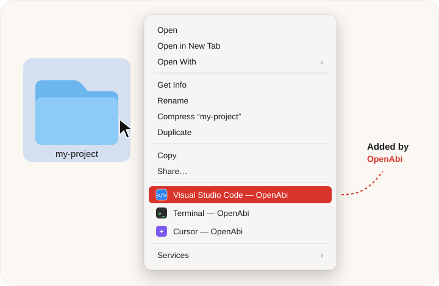

<div align="center">

<picture>
  <source media="(prefers-color-scheme: dark)" srcset="docs/assets/icon-dark.png">
  
</picture>

# OpenAbi

**Your files' big brother.**<br>
Drag an app onto a file type, and it shows up in Finder's right‑click menu.

[](https://github.com/firatmelih/OpenAbi/releases/latest/download/OpenAbi.dmg)


[](LICENSE)

[Website](https://firatmelih.github.io/OpenAbi/) · [Download](https://github.com/firatmelih/OpenAbi/releases/latest) · [Report a bug](https://github.com/firatmelih/OpenAbi/issues)

</div>

---

> **abi** */ah‑bee/* (Turkish): big brother. The one who always knows what to do with your stuff.

Tired of dragging folders onto the Dock or digging through **Open With ▸ Other…** every time? Tell OpenAbi once which apps belong to which kind of file. From then on, right‑click any match in Finder and open it in one click.

<p align="center">
  
</p>

## Features

- 🫳 **Drag and drop setup.** Drop any `.app` onto **Folders**, **All Files**, or a specific type like `.md`, `.json` or `.xcodeproj`.
- 🖱️ **Lives in Finder.** Items appear right in the context menu, with the app's own icon.
- 📂 **Folders and files.** Right‑click a folder, a file, several items at once, or the empty background of a Finder window.
- 🎯 **Smart matching.** Apps you added for a specific file type come first. With several items selected, you only see apps that match all of them.
- 🪶 **Tiny and native.** SwiftUI plus a Finder Sync extension. No Electron, no background app, no network access, no telemetry.
- 💻 **Universal.** Runs natively on Apple Silicon and Intel Macs.

## Install

1. **[Download OpenAbi.dmg](https://github.com/firatmelih/OpenAbi/releases/latest/download/OpenAbi.dmg)**.
2. Open it and drag **OpenAbi** into **Applications**.
3. Launch OpenAbi once. It turns on its Finder extension for you; the green dot at the top of the window confirms it.

OpenAbi is signed with a Developer ID and notarized by Apple, so it opens like any other app.

<details>
<summary><b>The menu items don't show up?</b></summary>

- Make sure the extension is on. Click **Enable in System Settings…** in OpenAbi, or go to **System Settings → General → Login Items & Extensions → Finder** (on macOS 14: **Privacy & Security → Extensions → Added Extensions**) and turn on **OpenAbi**.
- Keep only one copy of OpenAbi.app on your Mac (the one in **Applications**).
- Still nothing? Restart Finder: hold <kbd>⌥ Option</kbd>, right‑click Finder in the Dock, and choose **Relaunch**.

</details>

## Use

| You drop… | onto… | Right‑click in Finder shows |
| --- | --- | --- |
| Visual Studio Code | **Folders** | `Visual Studio Code — OpenAbi` on every folder |
| Terminal | **Folders** | `Terminal — OpenAbi` (opens a shell right there) |
| Typora | **.md** | `Typora — OpenAbi` on Markdown files |
| Xcode | **.xcodeproj** | `Xcode — OpenAbi` on project bundles |
| TextEdit | **All Files** | `TextEdit — OpenAbi` on any file |

- **Add a file type:** type extensions into the field at the bottom (`md, json, yml`) and press <kbd>Return</kbd>.
- **Remove an app:** click the ⓧ on its chip, or right‑click the chip → **Remove**.
- **Pick from a list:** click **+** on a card to choose apps with an Open panel instead of dragging.

You don't need to keep OpenAbi running. Finder loads the extension by itself, and changes apply immediately.

## How it works

```
┌──────────────────────┐   rules.json (App Group)   ┌──────────────────────────┐
│  OpenAbi.app         │ ─────────────────────────▶ │  Finder Sync extension   │
│  SwiftUI, drag & drop│                            │  builds the context menu │
└──────────┬───────────┘                            └────────────┬─────────────┘
           │ installs                                            │ runs on click
           ▼                                                     ▼
  ~/Library/Application Scripts/…/open-with.sh   ──▶   open -a "<App>" <items…>
```

Finder extensions must be sandboxed, and a sandboxed process isn't allowed to ask another app to open your files. So the main app installs a one‑line helper script into the extension's *Application Scripts* folder. macOS runs scripts from that folder outside the sandbox (via `NSUserUnixTask`). The script is just `open -a`.

Your rules stay on your Mac in `~/Library/Group Containers/XQH36L7379.com.melihfirat.OpenAbi/rules.json`.

## Build from source

Requires Xcode 26 or later (the icon is an Icon Composer `.icon`).

```bash
git clone https://github.com/firatmelih/OpenAbi.git
cd OpenAbi
open OpenAbi.xcodeproj   # then Run the "OpenAbi" scheme
```

In **Signing & Capabilities**, set your own team for both targets, and replace the `XQH36L7379` App Group prefix in `Config/*.entitlements` and `Shared/Rules.swift`.

To produce a signed (and optionally notarized) DMG:

```bash
scripts/release.sh                          # Developer ID signed DMG in ./dist
NOTARY_PROFILE=OpenAbi scripts/release.sh   # + notarize & staple
```

### Project layout

| Path | What's inside |
| --- | --- |
| `OpenAbi/` | The app: SwiftUI window, rule editing, helper-script installer, app icon |
| `FinderExtension/` | The Finder Sync extension that builds the menu and launches apps |
| `Shared/` | Rule model and storage used by both targets |
| `Config/` | Entitlements and the extension's `Info.plist` |
| `docs/` | The [website](https://firatmelih.github.io/OpenAbi/) (GitHub Pages) |

## Uninstall

Quit OpenAbi and move it to the Trash. To remove its leftover data too:

```bash
rm -rf ~/Library/Group\ Containers/XQH36L7379.com.melihfirat.OpenAbi \
       ~/Library/Application\ Scripts/com.melihfirat.OpenAbi.FinderExtension
```

## License

[MIT](LICENSE) © Melih Firat

<p align="center"><sub>Made with çay ☕ in Türkiye</sub></p>
